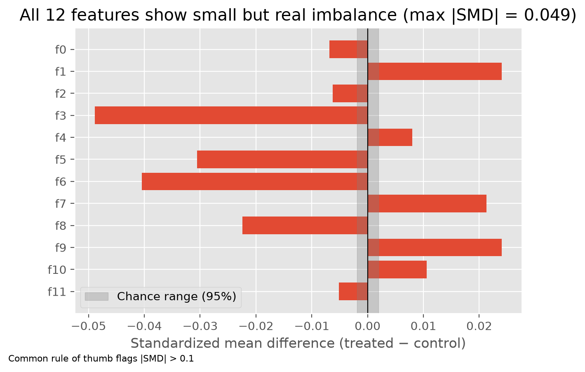

# Ad Incrementality Analysis: Criteo Uplift Dataset

Does online advertising cause users to visit a site, and for which people? An end-to-end analysis of a 13.9M-user randomized ad experiment, in SQL (DuckDB) and Python.

## Findings so far

**Phase 1: Is the experiment trustworthy?**
Confirmed that there is no leakage into the control data (confirmed by 02_sanity_checks.sql). The split ratio is 85% treatment and 15% control (treatment being able to be exposed to ads and control being not exposed to ads). Additionally, likely because of that, the SMD for all 12 of these features are not exactly balanced and are out of range from random chance, with the max at around 0.049. Practically, their averages are very close, but due to the extremely large sample size, they fall outside of chance range. Due to these circumstances, I performed the statistical analyses with both unadjusted and feature-adjusted effects to check whether this imbalance is significant. Only about 3.6% of treated users in this data were actually shown an ad. The effects on EXPOSED users are calculated differently.




## Data
Criteo Uplift Prediction Dataset v2.1 ([Hugging Face](https://huggingface.co/datasets/criteo/criteo-uplift)),
licensed CC BY-NC-SA 4.0. The data is not included in this repo.

Diemert, E., Betlei, A., Renaudin, C., & Amini, M.-R. (2018). *A Large Scale Benchmark for
Uplift Modeling.* AdKDD Workshop, KDD 2018.

## How to reproduce
```bash
uv sync
uv run python scripts/01_download.py
uv run python scripts/02_load.py
uv run python scripts/03_sanity.py
```

## Project structure
- `sql/`: all data aggregation queries
- `src/criteo_incrementality/`: Python helpers and estimators
- `analysis/`: notebooks that produce the figures
- `reports/`: figures and the final memo